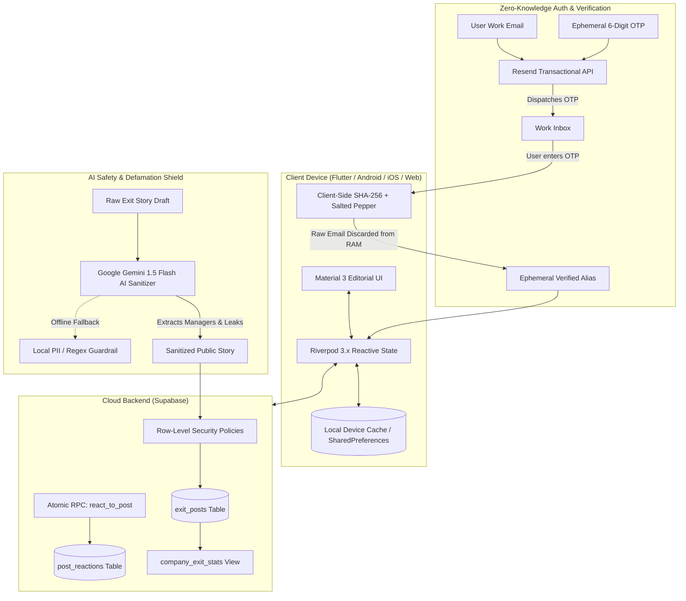
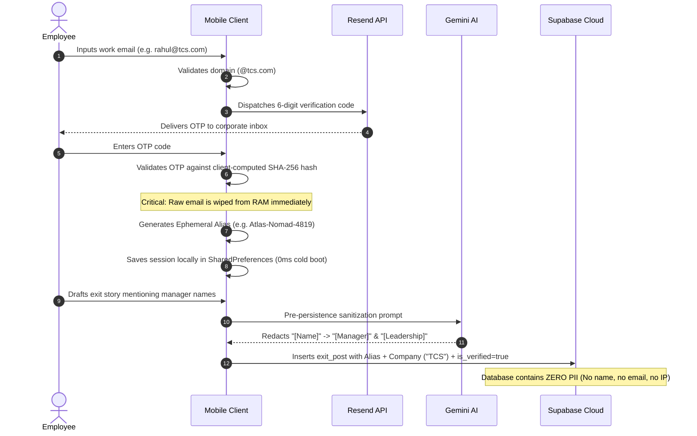

# Offboard (NoticePeriod) ⚡

> **The Zero-Knowledge Corporate Exit & Layoff Survival Network**  
> *Real corporate exit autopsies. Zero-knowledge privacy. Intermediary safe harbor. ₹0 serverless architecture.*

[](https://flutter.dev)
[](https://dart.dev)
[](https://supabase.com)
[](https://ai.google.dev)
[](https://resend.com)
[](https://riverpod.dev)
[](LICENSE)

---

## 🌟 Overview

**Offboard** (also known as *NoticePeriod*) is an enterprise-grade, anonymous mobile & cross-platform platform engineered for tech professionals navigating corporate exits, silent layoffs, and lengthy 90-day notice periods.

While platforms like Glassdoor have drifted toward corporate PR and Blind often suffers from unmoderated toxicity, **Offboard** is built on three core pillars:
1. **Zero-Knowledge Decoupling**: Proves corporate employment via work email without ever storing the email address or real name in the database.
2. **Statutory Intermediary Safe Harbor & Employer Balance**: Balances employee transparency with an official **Employer Right of Reply** and automated non-executive manager redaction via **Google Gemini AI**.
3. **₹0 High-Spike Serverless Stack**: Built on Flutter 3.41, Riverpod 3.x, Supabase (PostgreSQL 15), Resend, and client-side caching to handle 10,000+ viral user spikes without backend operational costs.

---

## 🏗️ System Architecture & Workflow

### 1. End-to-End Serverless Blueprint



---

### 2. Zero-Knowledge Decoupled Authentication

How Offboard proves an author worked at a company without creating any forensic digital trail linking their identity to their post:



---

## 🎯 Key Capabilities & Features

### 1. ⚡ Layoff Radar & The Breaking Point Receipts
* **Slack / Teams-Style Receipt Bubbles**: Exposes the exact conversational turning point that prompted resignation (e.g., manager cancelling approved leave, bait-and-switch appraisals).
* **Restructuring Radar**: Real-time signal intelligence tracking silent layoffs and stealth workforce reductions before they hit headlines.

### 2. 🛡️ Ephemeral Persona & Zero-Knowledge Hash Vault
* Instant generation of non-doxxable aliases (`Cipher-Sentinel-7102`, `Orion-Voyager-3419`).
* One-tap **Regenerate Alias** in the Profile Hub to dissociate all past comments from new postings.
* Persistent device-level session keeps users logged in across launches without repetitive OTP prompts.

### 3. ⚖️ Statutory Employer Balance & Right of Reply
* **Employer Right of Reply (Section 79 IT Act)**: Verified HR and People & Culture representatives can claim their company hub and post official rebuttals directly pinned to exit reviews.
* **Balanced Community Jury**: Instead of one-sided complaints, the community votes on three axes:
  * 🤝 **Valid Exit** (Community validates justified departure)
  * 🎯 **Dodged a Bullet** (Applauding escape from toxic conditions)
  * 🍿 **Employee Overreacted** (Accountability voting when an employee complaint is frivolous or unreasonable)
* **24h Grievance Redressal**: Built-in intake for reporting trade secret or NDA breaches to the platform's Resident Grievance Officer per Rule 3(2) of IT Rules 2021.

### 4. 📊 The Exit Index & Hall of Shame
* Aggregated attrition analytics per employer:
  * Average notice period days (comparing standard 30d vs draconian 90d policies).
  * Primary exit catalysts (% toxic management, low appraisal, forced RTO).
  * Post-resignation salary hike percentages (average +58%).

### 5. 🤝 Survival Cohorts & Escrow Alumni Referrals
* Private survival cohorts grouped by employer domain (e.g. *Amazon RTO Resistance*, *Infosys 90-Day Notice Navigators*).
* Direct alumni referral drops enabling exiting teammates to secure fast-track interviews.

### 6. 📝 HR-Compliant Exit Toolkit
* Auto-generates polite, legally sound formal resignation letters.
* Customizable notice periods (30/60/90 days), reason tones (Firm & Professional, Grateful, Neutral), and statutory requests for early release waivers.

---

## 📱 Screen-by-Screen Architecture

| Tab / Screen | Focus | Key Components |
| :--- | :--- | :--- |
| **1. Exit Feed** | Discovery & Viral Engagement | Pull-to-refresh, Filter chips carousel, Breaking point chat bubbles, Community jury voting meter, Floating autopsy action button. |
| **2. Exit Cohorts** | Anonymous Community Commons | Domain-verified company cohorts, Alumni referral drops, Peer survival channels. |
| **3. The Exit Index** | Metrics & Analytics | Attrition KPI cards, Top notice period offenders, Live restructuring bulletin, Average hike trackers. |
| **4. Exit Toolkit** | Resignation Generator | Dynamic letter builder, Early release waiver clause, Clipboard one-tap copy, Notice period survival strategies. |
| **5. Profile Hub** | Identity & Compliance | Active ephemeral persona, Zero-Knowledge Hash Vault status, Employer fairness portal, Resident Grievance Officer details, Secure session logout. |

---

## ⚖️ Legal & Policy Architecture

### 1. Intermediary Safe Harbor (Section 79 IT Act & Section 230 US CDA)
Offboard operates strictly as an intermediary under **Section 79 of the Indian Information Technology Act, 2000** and **Section 230(c)(1) of the US Communications Decency Act**.
* Following the Supreme Court of India's ruling in *Shreya Singhal v. Union of India (2015)*, the platform is not an active editor and is only obligated to remove content upon receipt of a **competent court order** or government directive under Section 69A.
* **Grievance Redressal SLA**: Rule 3(2) IT Rules 2021 compliance: Acknowledged within 24 hours, resolved within 15 days via `grievance@noticeperiod.internal`.

### 2. Defamation Law vs. Truthful Fair Comment (BNS Section 356)
* **First Exception to BNS Sec 356** (formerly IPC 499): Truthful statements made for public good are legally protected.
* **Mandatory Manager Redaction**: Naming individual middle managers or team leads crosses into personal slander. Offboard enforces automated scrubbing of individual non-executive names via **Google Gemini AI**.
* **Trade Secret & NDA Protection**: Strict prohibition of proprietary source code, internal client lists, and non-public financials.

---

## 🗄️ Database Schema & DDL

The database operates entirely on **Supabase (PostgreSQL 15)** with Row-Level Security:

```sql
-- 1. Anonymous Exit Posts (Zero PII Decoupled Schema)
CREATE TABLE IF NOT EXISTS public.exit_posts (
    id UUID PRIMARY KEY DEFAULT gen_random_uuid(),
    company_name TEXT NOT NULL,
    role TEXT NOT NULL,
    tenure_years NUMERIC(3, 1) NOT NULL,
    notice_days INT NOT NULL DEFAULT 90,
    current_notice_day INT,
    primary_reason TEXT NOT NULL,
    story_body TEXT NOT NULL,
    survival_tip TEXT NOT NULL,
    hike_percent INT NOT NULL DEFAULT 0,
    is_verified_work_email BOOLEAN NOT NULL DEFAULT false,
    is_layoff BOOLEAN NOT NULL DEFAULT false,
    open_to_refer BOOLEAN NOT NULL DEFAULT false,
    manager_quote TEXT,
    employee_reply TEXT,
    valid_exit_count INT NOT NULL DEFAULT 0,
    dodged_bullet_count INT NOT NULL DEFAULT 0,
    toxic_alert_count INT NOT NULL DEFAULT 0,
    created_at TIMESTAMPTZ NOT NULL DEFAULT timezone('utc'::text, now())
);

-- 2. Unique Reaction Ledger (Sybil / Spam Prevention)
CREATE TABLE IF NOT EXISTS public.post_reactions (
    id UUID PRIMARY KEY DEFAULT gen_random_uuid(),
    post_id UUID NOT NULL REFERENCES public.exit_posts(id) ON DELETE CASCADE,
    device_fingerprint TEXT NOT NULL,
    reaction_type TEXT NOT NULL CHECK (reaction_type IN ('valid', 'dodged', 'toxic')),
    created_at TIMESTAMPTZ NOT NULL DEFAULT timezone('utc'::text, now()),
    UNIQUE(post_id, device_fingerprint)
);

-- 3. Atomic Reaction RPC Function
CREATE OR REPLACE FUNCTION public.react_to_post(
    p_post_id UUID,
    p_device_fingerprint TEXT,
    p_reaction_type TEXT
)
RETURNS JSONB
LANGUAGE plpgsql
SECURITY DEFINER
AS $$
BEGIN
    INSERT INTO public.post_reactions (post_id, device_fingerprint, reaction_type)
    VALUES (p_post_id, p_device_fingerprint, p_reaction_type);

    IF p_reaction_type = 'valid' THEN
        UPDATE public.exit_posts SET valid_exit_count = valid_exit_count + 1 WHERE id = p_post_id;
    ELSIF p_reaction_type = 'dodged' THEN
        UPDATE public.exit_posts SET dodged_bullet_count = dodged_bullet_count + 1 WHERE id = p_post_id;
    ELSIF p_reaction_type = 'toxic' THEN
        UPDATE public.exit_posts SET toxic_alert_count = toxic_alert_count + 1 WHERE id = p_post_id;
    END IF;

    RETURN jsonb_build_object('success', true);
EXCEPTION
    WHEN unique_violation THEN
        RETURN jsonb_build_object('success', false, 'message', 'Already reacted');
END;
$$;
```

---

## 🚀 Getting Started

### Prerequisites
* [Flutter SDK 3.41+](https://docs.flutter.dev/get-started/install)
* [Dart SDK 3.11+](https://dart.dev/get-dart)
* Android Studio / VS Code with Flutter extension
* Chrome / Windows Desktop enabled for instant testing

### 1. Clone & Install
```bash
git clone https://github.com/Aayush-pixel29/offboard.git
cd offboard
flutter pub get
```

### 2. Configure Environment Variables (Optional)
The project comes pre-configured with client-safe test sandboxes. For production builds, pass your credentials via `--dart-define`:

```bash
flutter run \
  --dart-define=SUPABASE_URL=https://your-project.supabase.co \
  --dart-define=SUPABASE_ANON_KEY=your-supabase-anon-key \
  --dart-define=RESEND_API_KEY=your-resend-api-key \
  --dart-define=GEMINI_API_KEY=your-gemini-api-key
```

### 3. Run on Target Platform
```bash
# Run on Windows Desktop
flutter run -d windows

# Run on Google Chrome (PWA mode)
flutter run -d chrome

# Run on connected Android device / emulator
flutter run -d android
```

---

## 🔒 Security & Privacy Guarantees

* **Zero Plain-Text Emails**: Raw work emails are processed in client memory only for OTP verification, salted with a cryptographic pepper, and instantly discarded.
* **No Trackers**: Zero third-party behavioral analytics, ad SDKs, or social graphing trackers.
* **Brute-Force Shield**: Built-in 60-second OTP cooldown and automatic 15-minute lockouts after 5 failed verification attempts.
* **Decoupled Relational Keys**: Public posts and comments have no database relation or foreign key pointing to authentication tables.

---

## 📄 License

Distributed under the **MIT License**. See `LICENSE` for more information.

---

## 💡 Acknowledgements & Inspiration

* **Blind (Teamblind)** — For pioneering decoupled zero-knowledge work email authentication.
* **Glassdoor** — For proving the value of workplace transparency.
* **Linear** — For editorial UI and typography inspiration.
* **The Indian Tech Community** — For inspiring a platform dedicated to ending unfair 90-day notice traps and supporting professionals through layoffs.
